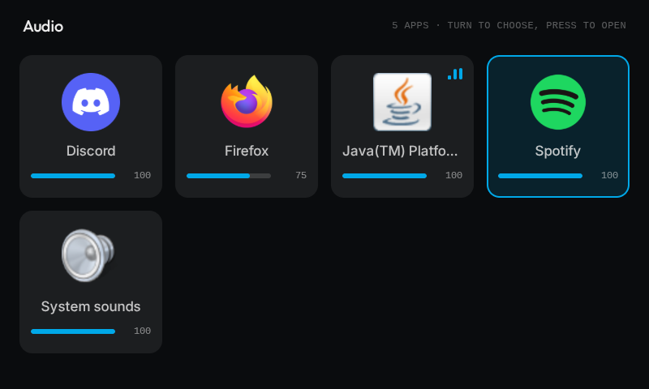
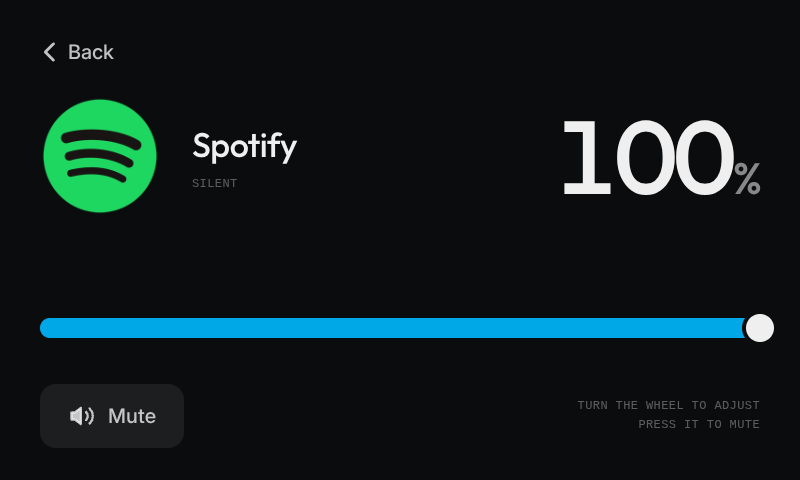

# audio-controller

A per-app volume mixer for a Spotify Car Thing running [BridgeThing](https://bridgething.com). It lists every Windows app that's playing audio, and the Car Thing's wheel sets each app's volume.

<p>
  
  
</p>

## What it does

- **The grid** shows every app with an audio session on your PC, across all output devices, with System sounds last. Each tile shows the app's icon, its volume, and moving bars while it plays.
- **An app's screen** shows a large volume readout, a slider and a Mute button.
- Changes go straight to Windows, so they match the Volume mixer in Windows settings.

## Controls

| Screen | Input | What it does |
| --- | --- | --- |
| Grid | Turn the wheel | Moves the selection |
| Grid | Press the wheel, or tap a tile | Opens that app |
| App | Turn the wheel | Changes the volume, and unmutes a muted app |
| App | Press the wheel, or tap Mute | Mutes or unmutes |
| App | Drag the slider | Sets the volume |
| App | The back button, or tap Back | Returns to the grid |

Each wheel click changes the volume by 2%, and clicks in a quick spin count double. You can set the step to 1, 2, 5 or 10% in this app's settings in the BridgeThing desktop app.

## Requirements

- A Car Thing running BridgeThing 0.16.0 or later.
- Windows 10 or 11, with the BridgeThing desktop app. It only works on Windows, because it uses the Windows Core Audio API.
- Nothing else. Windows PowerShell 5.1 compiles the helper with the .NET Framework that ships with Windows, so you don't need the .NET SDK.

## Install

1. Build the zip:
   ```bash
   bun install
   bun run build
   bun run share
   ```
   This writes `audio-controller-0.1.1.zip`.
2. In the BridgeThing desktop app, open the Store, choose **install from a file**, and pick the zip.
3. Accept the `run:powershell.exe` permission.
4. Open audio-controller on the Car Thing.

## Permissions

The extension asks for one permission, `run:powershell.exe`. Anything that can run PowerShell can do whatever your Windows account can, so check what it runs before you install it.

It runs one command, and you can see it in Task Manager (on the Details tab, add the Command line column):

```
powershell.exe -NoProfile -NonInteractive -Command "$ProgressPreference = 'SilentlyContinue'; $ErrorActionPreference = 'Stop'; Add-Type -Path '<install folder>\extension\AudioHost.cs' -ReferencedAssemblies System.Drawing; [AudioController.Host]::Run()"
```

That compiles [`extension/AudioHost.cs`](extension/AudioHost.cs), which ships in the zip as a plain file, and runs it. Nothing is encoded or downloaded, and the execution policy isn't bypassed. [`extension/audio.ts`](extension/audio.ts) builds that command, and it's the only process the extension starts.

### What the helper does

`AudioHost.cs` uses the Windows Core Audio API, the one behind the Volume mixer, to:

- list the apps that have audio sessions on your playback devices, with each app's volume, mute state and peak level
- set an app's volume, or mute and unmute it
- read each app's name and icon from its .exe

It opens no network connections, writes no files, changes nothing in the registry and starts no processes. It never reads another process's memory. The only access it asks for on another process is the right to read the path of its .exe. It talks to the extension over stdin and stdout, and exits when the extension stops.

## How it works

- `src/` is the webapp. It runs in the Car Thing's 800×480 kiosk (React and Tailwind) and only displays what the extension sends.
- `extension/` is a Deno program that the desktop app runs on your PC. It starts one `powershell.exe`, which compiles `AudioHost.cs` with `Add-Type` (about half a second) and then answers one JSON line per command: `list`, `volume`, `mute` or `icon`.
- `vite.config.ts` copies `AudioHost.cs` next to the extension's bundle, into `dist/extension/` for a build and `.dev-extension/build/` for the dev server. The extension finds it there.
- While the app is open on a Car Thing, the extension lists audio sessions every 500 ms and forwards them to the device. It stops polling when nothing has the app open.
- Sessions are grouped by normalized executable path, so an app with several sessions shows as one tile, and a volume change applies to all of them. Different executables with the same filename stay separate. Paths are hashed before being sent to the device; when Windows hides a path, sessions are grouped by process ID instead. Icons are taken from each executable at 128 px.
- If the PC disconnects or reports an error, the app screen shows the last known volume and disables its controls until a fresh session list arrives.

If you edit `AudioHost.cs`, keep it to C# 5. That's all `Add-Type` in Windows PowerShell 5.1 compiles, so there's no `$""`, `?.` or `out var`.

## Development

```bash
bun install
bun run dev          # page in your browser, extension under Deno, both linked to the connected Car Thing
bun run dev:device   # the same, with the page on the Car Thing's screen
bun run typecheck
bun run test         # Node 22.18+; native checks on Windows, UI checks with Chrome/Edge or CHROME_BIN
bun run build        # webapp, settings page and dist/extension/desktop.mjs
bun run share        # zips dist/ into audio-controller-<version>.zip
bun run push         # copies the webapp to the Car Thing, without the extension
```

If the desktop app also has this app installed, disable its extension there while you develop, or the page hears both copies. An edit to `AudioHost.cs` takes effect when the extension restarts, so save a file in `extension/` or restart the dev server.

| Path | What's there |
| --- | --- |
| `src/` | The webapp: grid, app screen, and the hook that talks to the extension |
| `settings/` | The settings page the desktop app shows |
| `extension/main.ts` | Polling, and the messages to and from the Car Thing |
| `extension/audio.ts` | Starts and talks to the PowerShell helper |
| `extension/AudioHost.cs` | The Core Audio helper |
| `public/` | `manifest.json` and the app icon |
| `vite.config.ts` | Copies `AudioHost.cs` next to the extension's bundle |

## Credits

The Inter and Outfit fonts in `src/fonts/` are under the SIL Open Font License.
